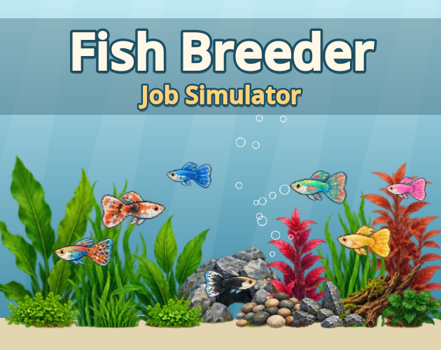
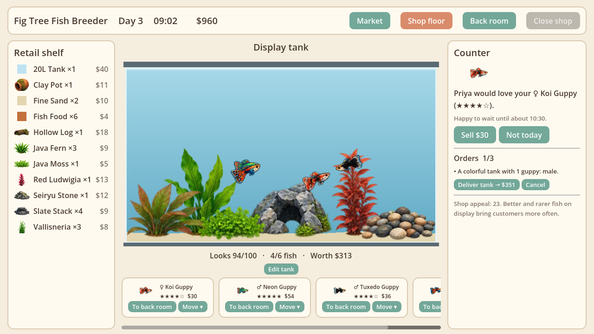
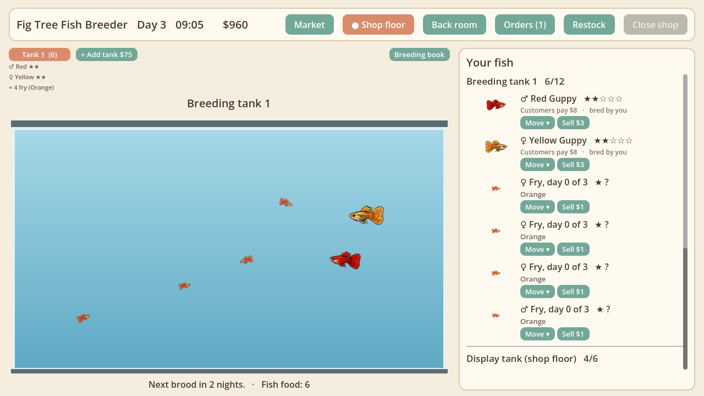
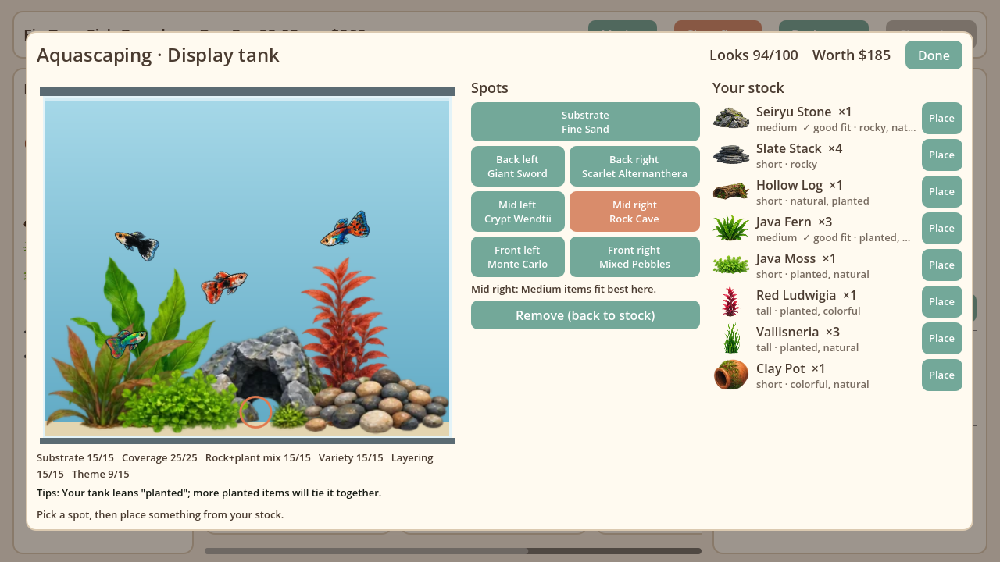
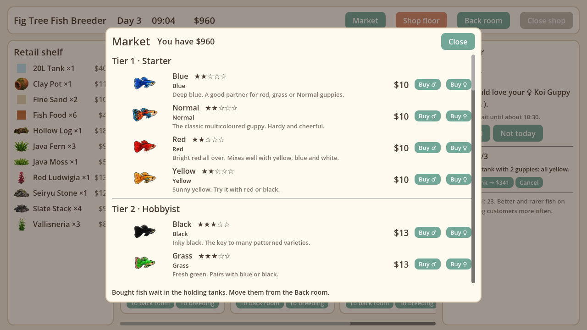

# Fish Breeder Job Simulator



A cozy 2D aquarium-shop game by **Fig Tree Games**, made in Godot 4.7.
Run a little fish store with a back room for breeding: pair guppies to discover
new varieties, build aquascapes from plants and rocks, and serve the customers
who wander in. No fish ever die, nothing punishes you, and there's no rush.

**Play it in your browser:** <https://figtreegames.itch.io/fish-breeder-job-simulator>

Current version: **0.6.2** (see the [changelog](CHANGELOG.md)).

| Shop floor | Back room |
|---|---|
|  |  |
| **Tank editor** | **Market** |
|  |  |

## How to play

- **Open the shop** each morning. The clock runs from 09:00 (an in-game hour is
  48 real seconds), and you can close once you've been open 4 hours (or stay
  open until 21:00).
- **Customers** come to the counter and ask for a fish, a shelf item, or your
  whole display tank. Sell, or say "Not today" (there's never a penalty).
  - Better and rarer fish on display bring customers in more often.
  - Some customers have a **request** ("a planted tank with 2 orange guppies").
    Accept it, build it, then deliver it for the tank's value plus a bonus.
  - If they want something you don't have, you can **order it in** for them
    at 10% off and hand it over later.
  - The counter shows what you paid for a fish and what they'll pay. If
    selling would be a loss, **Breed one** keeps your fish and promises them
    one like it in 2–3 days, at the same price.
- **The back room** holds your breeding tanks: one to start, up to four if you
  buy more. Put an adult male and female in a tank and every couple of nights
  they have a brood of fry. Feed them (fish food) and they grow up in 3 days,
  revealing their star rating (1–5). Fry keep growing if you move them to the
  holding tanks, which is handy when a breeding tank gets crowded. Fish only breed with others in the same
  tank, so you can keep lines apart. Each tank's tab lists the fish inside.
- **Move ▾** on any fish sends it to the display tank, a breeding tank or holding.
- **The Market** has three tabs: **Fish** (named guppy strains in four price
  tiers; they cost more than customers pay, so the profit is in breeding them), **Decorations** (plants, rocks, driftwood, decor) and **Supplies**
  (tanks, fish food, substrate).
- **The tank editor** lets you place substrate and six items (back, middle,
  front). A live looks score and tips show how to make it prettier, and
  prettier tanks sell for more.
- **Wholesaler:** any fish, even fry, can be sold instantly for less than a
  customer would pay, to make room or clear out a line you don't like.
- **Restock** (top bar) closes the shop to customers and runs time 4× faster to
  build up stock by breeding; press **Reopen** to go back to normal.
- In the back room, a bell rings and the **● Shop floor** button lights up
  when someone's waiting at the counter.

### Breeding guppies

There are 24 guppy varieties. Each baby takes mum's or dad's variety, but:

- **Recipes:** some pairs can make something new (about 30% of the time).
  Try **Red × Yellow**, **Red × Blue** or **Black × White** to start.
  There are 15 recipes to discover.
- **Mutations:** very rarely a fry is born **Albino** or **Glass**, the most
  valuable varieties of all. They're never sold in the Market.

The end-of-day summary celebrates new varieties and mutations.

## Running the project

- Open the folder in **Godot 4.7** and press **F5**.
- Debug builds only: hold **F** to fast-forward the clock.
- Fish art gallery: open `scenes/debug/fish_gallery.tscn` and press **F6**.

### Tests

The game rules live in `scripts/core/` as plain GDScript (no scenes), covered by
headless unit tests:

```bash
godot --headless --path . -s res://tests/run_tests.gd
```

See [tests/README.md](tests/README.md) for details.

### Publishing to itch.io

`tools/publish_web.ps1` runs the tests, builds the web version and uploads it
with [butler](https://itch.io/docs/butler/):

```powershell
.\tools\publish_web.ps1 0.6.2
```

## Project layout

```
data/          Game content as JSON: species, items, strains, requests, economy
scripts/core/  Pure game logic: genetics, pricing, customers, tanks, day cycle
scripts/autoload/game.gd   Connects the logic to the UI and runs the clock
scenes/        Shop floor, back room, tank view, fish renderer, menus (scenes/ui)
assets/        Sprite sheets (fish, decor) and the bundled DejaVu Sans font
tools/         Sheet cutter, cover/screenshot renderers, publish script
tests/         Headless test runner and unit tests
docs/          Design doc, plan, images
```

Content is data-driven: new items, strains, recipes or even species go in
`data/` without code changes. See [docs/DESIGN.md](docs/DESIGN.md) for the
full design and decision log.

## Credits

- Game: Fig Tree Games
- Guppy and aquascape sprite sheets: supplied by Fig Tree Games
- Font: [DejaVu Sans](https://dejavu-fonts.github.io/) (free licence, see
  `assets/fonts/LICENSE_DEJAVU.txt`)
- Engine: [Godot](https://godotengine.org/)
